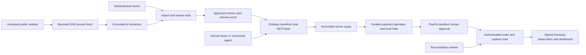

# Architecture and authority

Database collections: users, emails, sessions; shops/slugs; immutable catalogs; quotes; checkouts; operations; inventory/reservations; refundProposals/refundApprovals/refundConfirmations; webhooks; receipts; runs; unmetIntents; audit. JSON envelopes have fixed collection/id keys, revision and timestamps. Unique indexes cover operation request keys, checkout quote/provider order/capture identifiers. Advisory locks cover missing rows as well as row locks. PGlite is a development fallback; full PostgreSQL is the deployment path.

Catalog: DRAFT → explicit owner review → APPROVED → shop.publishedVersion. Editing creates another DRAFT, never silently alters the published immutable version. Unknown/conflicting product fields and rules block approval. Publication requires logged-in shop owner and proof token on the configured domain. Local synthetic fixture verification has separate disclosure. Stock publication updates do not replenish sold units on price-only changes.

Quote binds shop/catalog/rules version, prices/discount, quantities, currency and pickup date. Published version, inventory and rules are rechecked at checkout. Changed catalog requires a new quote and approval. Monetary arithmetic uses integer minor units; current currencies GBP/USD/EUR only. Bulk discount is integer percentage configured by owner. Alternatives require explicit owner permission and exact approved dietary labels; changing an order requires buyer choice/new quote.

Payment states: CREATING → AWAITING_APPROVAL → APPROVED → CAPTURING → PAID; PENDING, UNKNOWN, DECLINED, CANCELLED and MISMATCH remain distinct; PARTIALLY_REFUNDED/REFUNDED require authenticated refund observation. Provider responses and webhook claims alone do not create PAID. Verify expected payee, amount, currency, reference IDs, completed capture and order linkage by authenticated reads.

Each create/capture/refund operation is persisted with immutable request digest and distinct stable PayPal-Request-Id before network I/O. Claims use durable leases. Order ID is saved before capture. No uncertain request is resolved by another order. Six-hour conservative retention cutoff prevents unsafe retries after provider deduplication may expire. Regular worker reads compensate for missing webhooks. Verified events are deduplicated by event ID+payload hash; events trigger authenticated reads rather than determine money truth.

Inventory uses a per-shop transaction lock and separate physical on-hand ledger. Starting checkout atomically reserves local units for up to3minutes. Before capture HTTP the reservation is durably pinned; an UNKNOWN capture cannot expire into available stock. Authenticated definite no-capture/cancellation enables safe release. Completed capture decrements once. Refund does not mean physical goods returned. This does not coordinate external POS inventory.

Only owners can propose/confirm a refund; browser shows exact amount/order. Retried confirmation reuses the same approval and refund key. Pilot supports one full/partial refund operation per checkout. Receipts use canonical JSON+Ed25519, checked against the deployment's trusted public key, and explicitly sign a Doorway observation rather than PayPal's signature or delivery guarantee.

Sessions store only token hashes, expire after7days and use HttpOnly/SameSite cookies. Browser writes enforce exact APP_URL Origin. Checkout capabilities are HMAC-bound to one ID and7-day expiry, never owner/refund authority. Unpredictable receipt URLs contain transaction observation only. No buyer email/address is stored. Public catalog projection excludes owner review identifiers. Secrets are server-side, logs redact details. DNS answers/redirects/body/time/page limits prevent private network fetching; untrusted source text is never a tool instruction. Model tools are bounded and cannot publish, verify ownership, refund or mark payments paid.

API uses `{data:...}` or `{error:{code,message}}`. Owner endpoints `/api/shops/:id/*`; public store `/api/store/:slug`; capabilities `/api/checkouts/:id?access=...`; receipt `/api/receipts/:id`; verified provider webhook `/api/paypal/webhook`; bearer worker `/api/internal/reconcile`. Official MCP `/api/mcp/:slug` accepts stateless POST Streamable HTTP and validated schemas; no caller-controlled tenant/price/preview. Public tool discovery also requires publication. Readiness is evidence-based, separate from service-configuration presence.
